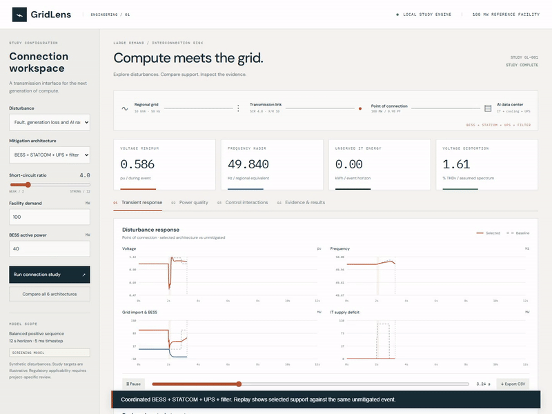
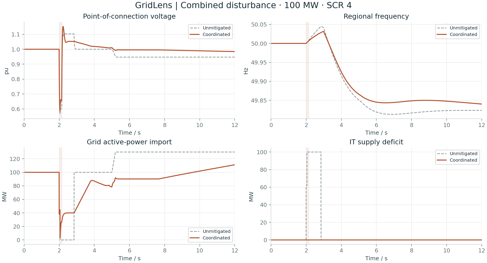
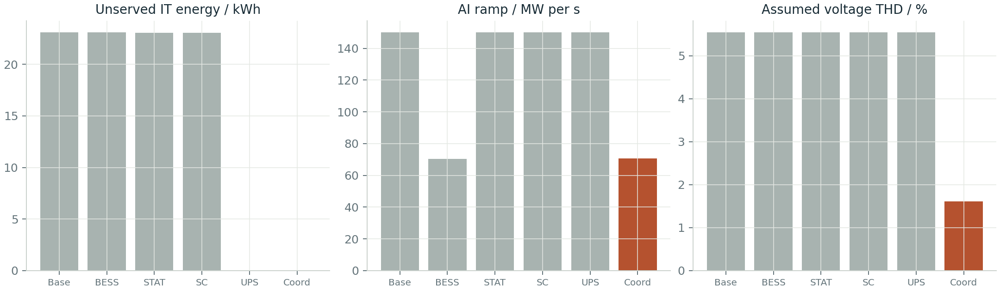

# GridLens

### Grid code risk assessment for large data-center interconnections

A runnable engineering study bench for a **100 MW data center**: nonlinear network screening, dynamic disturbances, six mitigation architectures, measured HPC loading sensitivity, and a browser interface that makes the results inspectable.

   

**[Watch the working demo](results/gridlens-demo.mp4)** · **[Technical findings](docs/findings.md)** · **[Model equations](docs/model.md)** · **[Research register](docs/research.md)** · **[Resume / interview handoff](docs/RESUME_HANDOFF.md)**

[](results/gridlens-demo.mp4)

> This is an original Python **screening project**. The dashboard runs real calculations, but the grid events are synthetic. It does not claim grid-code certification, a validated GFM implementation, or completed PSCAD / PowerFactory / PSS®E studies. The external-tool handoff and CSV comparison are documented and tested.

## Start in three minutes

```bash
git clone https://github.com/Pavan-amikula/gridlens.git
cd gridlens
python -m venv .venv
# Windows PowerShell:
.venv\Scripts\Activate.ps1
# Linux / macOS: source .venv/bin/activate
python -m pip install -e ".[dev]"
python -m gridlens.server
```

Open **[localhost:8000](http://localhost:8000)**. Select a disturbance and mitigation, change SCR or facility size, then run. Compare architectures, replay the response, inspect local controller modes, and export the full CSV. Core calculations and plots need no cloud account or API key. Optional Google-hosted fonts fall back to system fonts offline.

## What the study found

Reference case: 100 MW, SCR 4, 150 ms upstream sag, 200 MW regional generation loss and a 30 MW / 0.2 s AI load ramp. All alternatives see the same disturbance.

| Metric | Unmitigated | Coordinated reference | Tuned candidate |
|---|---:|---:|---:|
| Support configuration | None | 40 MW / 20 MWh BESS, 50 MVA envelope, 60 ms response | 60 MW / 20 MWh BESS, 80 MVA envelope, 10 ms response |
| Minimum point-of-connection voltage | 0.564 pu | 0.586 pu | 0.586 pu |
| Regional frequency nadir | 49.813 Hz | 49.840 Hz | 49.840 Hz |
| AI ramp, 100 ms window | 150.0 MW/s | 70.6 MW/s | **14.7 MW/s** |
| Unserved IT energy | 23.08 kWh | 0.00 kWh | 0.00 kWh |
| THDv, assumed harmonic spectrum | 5.54% | 1.61% | 1.61% |
| Illustrative engineering targets met | 2 / 5 | 4 / 5 | 5 / 5 |
| Finnish grid-demand recovery screen | Endpoint meets screen; transfer risk remains | **Recovery risk** | **Recovery risk** |

The tuned candidate reduces the AI ramp metric by **90.2%** relative to baseline. This result depends on assumed controller bandwidth, capacity, load and network data; it is not vendor-validated equipment performance. Passing five illustrative study targets does not establish legal compliance.

Timestep sensitivity matters: the candidate ramp is 14.68 / 16.30 / 17.35 MW/s at 5 / 2.5 / 1 ms. It remains below the 20 MW/s target at all three steps; the reduction is **88.4% at 1 ms**. See [candidate convergence](results/candidate_convergence.csv).

**The central finding:** preserving IT supply and preserving grid demand during a fault are different objectives. UPS transfer and ramp buffering can protect compute while delaying grid-demand recovery. The reference coordinated case imports about **55.5%** of pre-fault demand at the Finnish recovery-screen deadline; the tuned candidate reaches about **75.5%**, below the 90% criterion. Both retain a complete-transfer risk in the assumed protection logic. This is a control/protection redesign priority, not a successful connection certificate.



## Study coverage

- **108 matrix entries**: six scenario views × six architectures × SCR 2/4/8. Fault and recovery use an identical stimulus, so the matrix contains **90 unique configurations**.
- Six architectures: unmitigated, BESS droop/ramp support, STATCOM, synchronous-condenser surrogate, MV UPS, and coordinated support with assumed filtering.
- Nonlinear radial AC power balance; voltage-dependent demand; regional swing/governor response; protection transfer/recovery; battery power, efficiency, energy and SOC constraints.
- Power-quality screening, a local two-state controller eigenvalue/gain sweep, three timestep convergence cases, and **12 capacity/bandwidth tuning cases**.
- Six additional operating-point studies informed by **2,022 measured PM100 power samples from 30 jobs**. The small head subset is not statistically representative and does not validate subsecond AI behavior.
- **15 automated tests**, plus browser verification of runs, tabs, control changes, architecture comparison, CSV export, replay, responsive layout and JavaScript errors.



## Requirements and evidence

| Thesis requirement | Delivered evidence | Boundary / follow-on work |
|---|---|---|
| European / Nordic grid-code review | [Cited applicability register](docs/research.md), EU DCC, Swedish implementation, Finnish June 2026 rules, draft KJV2026 and storage SJV2024 distinction | Denmark, Norway and project-specific connection terms need separate detailed profiles |
| Voltage ride-through and recovery | Voltage sag, protection transfer, post-fault import endpoint screen | Full national voltage envelope and vendor protection qualification are not executed |
| Voltage / frequency stability | Nonlinear radial interface, coherent-area frequency response, SCR sweep | No multi-area, unbalanced or EMT stability claim |
| Control interactions | Reactive-loop eigenvalues and gain/SCR sweep | No PLL, switching, multi-converter or GFM control validation |
| Power quality / filtering | Harmonic current-source voltage screening and assumed attenuation | Requires measured spectrum, background distortion and resonance scan |
| Load ramping | AI step/ramp, cyclic load, 100 ms ramp metric, finite-bandwidth BESS tuning | Workload predictor and validated converter delay are future work |
| BESS / STATCOM / condenser / MV UPS | Identical-scenario comparison with explicit energy and rating constraints | Condenser and UPS models are aggregate surrogates |
| PSCAD / PowerFactory / PSS®E | [Study handoff](docs/licensed-tool-validation.md), validated CSV import and trace comparison | Licensed native models and simulator execution are **not completed** |
| Recommendations / best practices | [Findings and priorities](docs/findings.md) | Formal approval needs TSO-agreed models and acceptance tests |

The source register distinguishes binding rules, national implementation, drafts, research and assumptions. In particular, **SJV2024 applies to storage**; it is not the generic demand-facility code. The Finnish June 2026 supplementary requirements are distinguished from the KJV2026 consultation draft. Short simulations cannot prove frequency withstand obligations lasting minutes.

## Reproduce and inspect

Run from the repository root after editable installation:

```bash
pytest -q
python scripts/run_studies.py
python scripts/tune_controls.py
# With the dashboard server running, and Chromium installed:
python -m playwright install chromium
python scripts/browser_qa.py
python scripts/record_demo.py
# Compare aligned licensed-tool CSV exports:
python scripts/compare_external.py results/traces/baseline.csv path/to/vendor.csv
```

`run_studies.py` regenerates the complete matrix, six reference traces, convergence results, controller sweep, summary and figures. `tune_controls.py` retains all 12 tuning cases and the selected candidate. The summary includes the model source SHA-256 and runtime. CI runs the numerical tests and publishes regenerated evidence as an artifact.

The optional measured-data extraction requires `pip install pyarrow` and the original 287 MB PM100 Parquet. See [dataset provenance](data/README.md) for its checksum, exact extraction, license and attribution. The dashboard uses the small supplied subset/provenance; downloading the original is not required to run it.

## Repository guide

```text
gridlens/             numerical engine, local API, CSV result exchange
web/                  original responsive dashboard; no JS framework/build step
tests/                physical balance, energy/rating limits, convergence, API, exchange
scripts/              matrix, tuning, dataset extraction, UI QA and real screen recording
data/                 attributed PM100 subset and machine-readable provenance
results/              all cases, traces, figures, checks, demo MP4 and GIF
docs/                 source register, equations, findings, tool handoff, resume brief
.github/workflows/    repeatable engineering checks
```

## Research and design references

Primary references include [EU 2016/1388](https://eur-lex.europa.eu/eli/reg/2016/1388/oj), [Fingrid requirements](https://www.fingrid.fi/en/grid/grid-connection-agreement-phases/grid-code-specifications/), [Svenska kraftnät DCC implementation](https://www.svk.se/om-kraftsystemet/legalt-ramverk/eu-lagstiftning-/natanslutning-av-forbrukning-dcc/), [ENTSO-E's 2026 data-center report](https://www.entsoe.eu/news/2026/05/08/from-energy-demand-to-grid-support-entso-e-explores-data-centres-dual-role/), [PNNL's data-center EMT modeling work](https://www.pnnl.gov/publications/electromagnetic-transient-modeling-large-data-centers-grid-level-studies), and [PM100](https://doi.org/10.5281/zenodo.10127767). See the [full register](docs/research.md) for clauses, model papers and applicability.

[pandapower](https://github.com/e2nIEE/pandapower) and [VeraGrid](https://github.com/SanPen/VeraGrid) were reviewed as examples of inspectable power-system tooling. The interface uses original code and assets, organized around a single-line view, unit-labeled traces, requirements and evidence. Neither project's solver or UI code is copied into GridLens.

Software: [MIT](LICENSE). PM100 data: [CC BY 4.0](data/README.md). Referenced publications retain their respective rights. This independent portfolio project is not affiliated with Hitachi Energy or a TSO.
